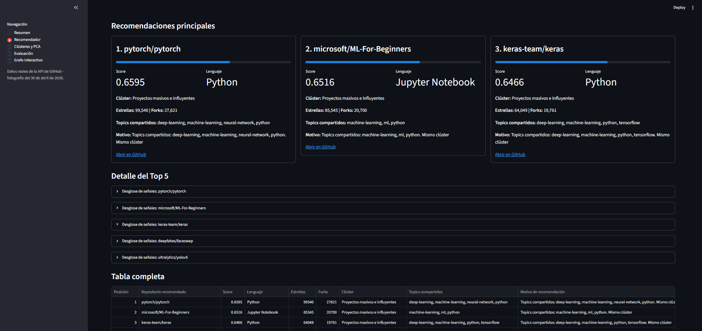
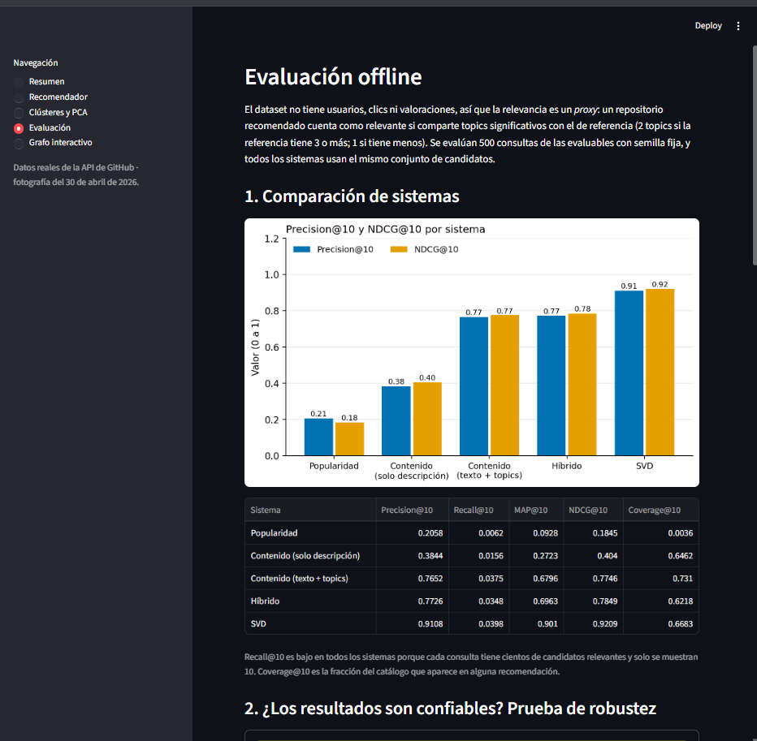
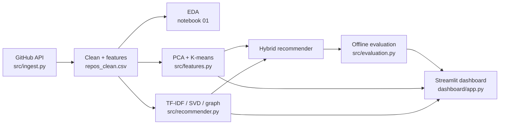
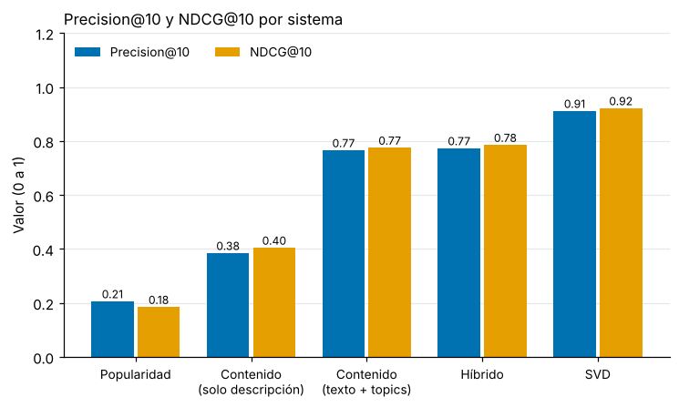
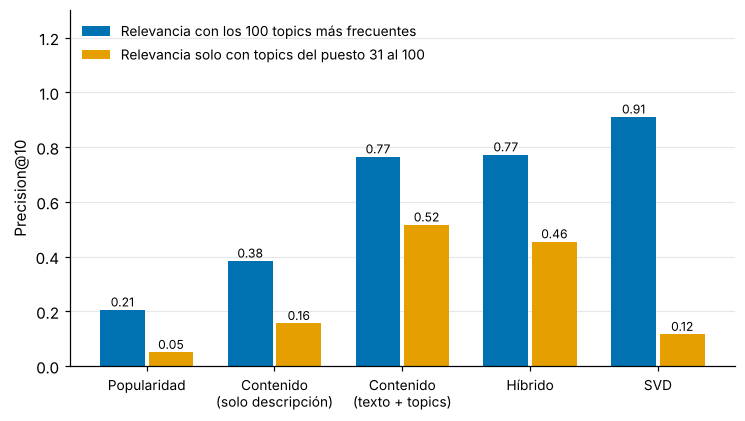
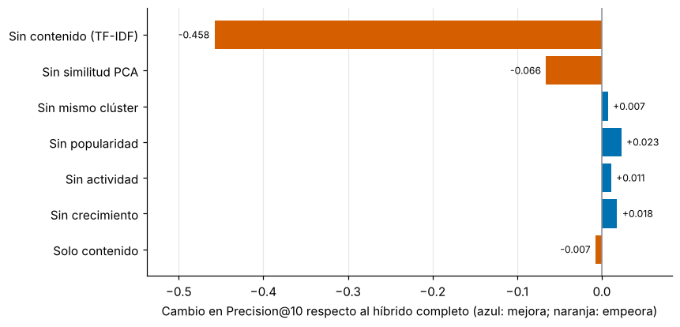

# AI Repository Discovery

Discovery and recommendation of AI research repositories on GitHub. The project collects repository
metadata from the GitHub REST API, explores and clusters it (EDA, PCA, K-means), builds a hybrid
recommender, evaluates it offline against honest baselines, and serves everything in a Streamlit dashboard.

The dashboard interface is written in Spanish.




## Dataset
3,034 public repositories (at least 50 stars, AI research topics) extracted from the GitHub API on
2026-04-30. 15 columns, 41 languages, median 2,174 stars. See [`data/README.md`](data/README.md).

## Pipeline


Everything the dashboard shows is computed by code in `src/` and checked by tests against the published
metrics, so the recommender in the app is the same one that was evaluated.

## Results
Offline evaluation, Precision@10 over 500 sampled queries (seed 42). Relevance is a proxy: a repository is
relevant if it shares enough of the 100 most frequent topics with the query.

| System | Top-100 topics | Topics 31–100 only |
|---|---|---|
| Popularity | 0.206 | 0.051 |
| Content (description only) | 0.384 | 0.156 |
| Content (text + topics) | 0.765 | 0.516 |
| Hybrid PCA + K-means | 0.773 | 0.455 |
| SVD on repo–topic matrix | 0.911 | 0.117 |

What this says, honestly:
- **SVD's lead is circular.** It is built from the same topics used to define relevance. When relevance uses
  topics SVD never sees (31–100), it falls to 0.117.
- **The hybrid does not beat plain content on topical precision** (0.455 vs 0.516 in the robust protocol).
  Its extra signals (popularity, recent activity, growth, cluster) are a product decision: they favour
  maintained, popular repositories.
- **Ablation:** removing text content costs 45.8 points of Precision@10; removing PCA similarity costs 6.6.
- **Data quality experiment:** two of the five K-means clusters are tiny (56 and 5 repositories) because stars
  and forks enter PCA unscaled. With log scaling the smallest cluster has 437 repositories and the hybrid
  reaches 0.784. Dropping incomplete rows instead of imputing them loses 289 repositories and slightly lowers precision.





## Quick start
```bash
python -m venv .venv && source .venv/bin/activate      # Windows: .venv\Scripts\activate
pip install -r requirements.txt
python src/run_pipeline.py                             # sanity check of every dashboard dependency
streamlit run dashboard/app.py
```
More commands (tests, regeneration, new GitHub snapshot) in [`RUNBOOK.md`](RUNBOOK.md).

## Structure
```
dashboard/   Streamlit app (app.py, ui.py, sections/)
src/         ingest, features, recommender, evaluation, graph, build_artifacts, run_pipeline
notebooks/   01 EDA · 02 features · 03 clustering · 04 recommendation · 05 graph/PageRank
data/        processed snapshot, raw sample, data card
artifacts/   generated tables and graph files used by the dashboard
reports/     figures and written reports
tests/       pytest suite
docs/        images and report corrections
```

## Limitations
- Relevance is a topic-overlap proxy, not human judgement.
- The snapshot is a point in time; stars and activity change daily.
- 48 % of the repositories have had no push for over a year.
- Cluster sizes are very uneven (see above); the published clustering was kept for consistency with the reports.
- The exact search queries of the original extraction were not preserved; `DEFAULT_QUERIES` is a reconstruction.
